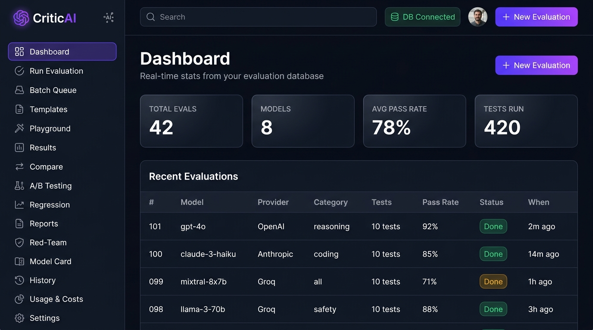

# CriticAI — Multi-Agent LLM Evaluation System

<div align="center">

[](https://critic-ai-application.vercel.app)
[](https://criticai-backend.onrender.com/docs)
[](https://github.com/ITSYOURAHLAWAT/CriticAI)
[](LICENSE)
[](https://www.python.org/)
[](https://react.dev/)

**A production-ready, multi-agent LLM evaluation platform. Run automated tests across AI models, benchmark performance, detect regressions, and get rich analytics — entirely free.**

[🌐 Open Live App](https://critic-ai-application.vercel.app) · [📖 API Docs](https://criticai-backend.onrender.com/docs) · [🐛 Report Bug](https://github.com/ITSYOURAHLAWAT/CriticAI/issues)

</div>

---



---

## Table of Contents

- [What is CriticAI?](#what-is-criticai)
- [Key Features](#key-features)
- [Live Deployment](#live-deployment)
- [Architecture Overview](#architecture-overview)
- [Getting Started (Local Dev)](#getting-started-local-dev)
- [Usage](#usage)
- [Contributing](#contributing)
- [Roadmap](#roadmap)
- [License](#license)

---

## What is CriticAI?

**CriticAI** is a full-stack, end-to-end framework for evaluating Large Language Models (LLMs) automatically. It orchestrates a team of specialized AI agents to:

1. **Generate** diverse test cases across categories (reasoning, coding, math, summarization, red-team).
2. **Evaluate** model responses using scoring agents with customizable rubrics.
3. **Benchmark** multiple models side-by-side in A/B tests and regression checks.
4. **Report** rich analytics — pass rates, token usage, latency, model cards — through a premium dark-themed dashboard.
5. **Stream** evaluation progress in real-time via Server-Sent Events (SSE).

Built with **Python 3.11 + FastAPI** (backend) and **React 18 + Vite** (frontend), deployed free on **Render** + **Vercel**.

---

## Key Features

| Feature | Description |
|---------|-------------|
| 🤖 **Multi-Agent Orchestration** | LangGraph-powered agents for test generation, evaluation, red-teaming, and reporting |
| 🔄 **Real-time Streaming** | Live SSE-based progress updates during evaluations |
| 📊 **Rich Analytics Dashboard** | Pass rates, model comparisons, A/B tests, regression detection |
| 🏃 **Batch Queue** | Queue multiple evaluations and run them in parallel |
| 🎯 **Playground** | Interactive single-prompt tester with side-by-side model comparison |
| 🛡️ **Red Team Mode** | Adversarial testing to discover model failure modes |
| 📋 **Model Cards** | Auto-generated performance snapshots per model |
| 🔌 **Multi-Provider** | Groq, Gemini, OpenAI, Ollama — all free tiers supported |
| 📁 **Template Library** | Reusable evaluation templates for common tasks |
| 📈 **Token Usage Tracking** | Monitor API costs across providers |

---

## Live Deployment

| Component | URL | Platform |
|-----------|-----|----------|
| 🌐 **Frontend** | [https://critic-ai-application.vercel.app](https://critic-ai-application.vercel.app) | Vercel (Free) |
| ⚙️ **Backend API** | [https://criticai-backend.onrender.com](https://criticai-backend.onrender.com) | Render (Free) |
| 📖 **API Docs** | [https://criticai-backend.onrender.com/docs](https://criticai-backend.onrender.com/docs) | Render (Free) |

> [!NOTE]
> The backend runs on Render's free tier, which **spins down after 15 minutes of inactivity**. The first request after a sleep period may take 20–50 seconds to respond while Render wakes the service. Subsequent requests are fast.

---

## Architecture Overview

```
┌────────────────────────────────────┐
│   Frontend (React 18 + Vite)       │  ← Vercel
│   └─ /frontend/src/pages/          │
│      Dashboard, Playground, etc.   │
├────────────────────────────────────┤
│   API Layer (FastAPI + uvicorn)    │  ← Render
│   └─ /api/main.py                  │
├────────────────────────────────────┤
│   Agent Orchestration (LangGraph)  │
│   ├─ orchestrator/graph.py         │
│   ├─ agents/test_generator.py      │
│   ├─ agents/evaluator_agent.py     │
│   ├─ agents/red_team_agent.py      │
│   └─ agents/reporter_agent.py      │
├────────────────────────────────────┤
│   RAG Layer (ChromaDB)             │
│   └─ rag/chroma_store.py           │
├────────────────────────────────────┤
│   Database (SQLite)                │
│   └─ criticai.db                   │
└────────────────────────────────────┘
```

---

## Getting Started (Local Dev)

### Prerequisites

- **Python 3.11+**
- **Node.js 18+**
- **Git**

### 1. Clone the repo

```bash
git clone https://github.com/ITSYOURAHLAWAT/CriticAI.git
cd CriticAI
```

### 2. Backend setup

```bash
# Create and activate a virtual environment
python -m venv .venv
.venv\Scripts\activate        # Windows
# source .venv/bin/activate   # macOS / Linux

# Install Python dependencies
pip install -r requirements.txt

# Copy the environment template and add your API keys
copy .env.example .env
# Edit .env and add: GROQ_API_KEY, GEMINI_API_KEY (both free, no card needed)
```

### 3. Start the backend

```bash
uvicorn api.main:app --reload --host 127.0.0.1 --port 8000
# API docs: http://127.0.0.1:8000/docs
```

### 4. Frontend setup (new terminal)

```bash
cd frontend
npm install
npm run dev
# App runs at http://localhost:5173
```

### Free API Keys

| Provider | URL | Free Tier |
|----------|-----|-----------|
| Groq | [console.groq.com](https://console.groq.com) | ✅ No card needed |
| Gemini | [aistudio.google.com](https://aistudio.google.com) | ✅ No card needed |
| Ollama | [ollama.com](https://ollama.com) | ✅ Local, fully free |

---

## Usage

### Run your first evaluation

1. Open the app → click **"Run Evaluation"** in the sidebar.
2. Enter a model name (e.g. `mixtral-8x7b-32768`), select provider `Groq`.
3. Choose a test category (e.g. `reasoning`) and number of tests.
4. Click **"Run Evaluation"** — watch results stream in real-time!

### CLI Commands

| Command | Description |
|---------|-------------|
| `python cli.py test` | Run all tests and generate a report |
| `python cli.py report --format html` | Generate an HTML report |
| `python cli.py serve` | Start the FastAPI backend |
| `python cli.py --help` | Full list of options |

---

## Contributing

Contributions are welcome! Please follow these steps:

1. **Fork** the repository.
2. Create a feature branch: `git checkout -b feature/your-feature`.
3. Write tests for your changes.
4. Submit a **pull request** with a clear description.

### Code Style

- Python: `black`, `isort`, `flake8`
- JavaScript/React: `prettier`

---

## Roadmap

| Milestone | Target | Description |
|-----------|--------|-------------|
| **v1.0** ✅ | Aug 2026 | Core evaluation runner + premium dashboard |
| **v1.1** 🔄 | Q4 2026 | Full LLM orchestrator + training pipeline |
| **v2.0** 📅 | 2027 | Multi-cloud deployment + advanced analytics |

---

## License

MIT © 2026 CriticAI. See the [LICENSE](LICENSE) file for details.

---

## Acknowledgements

- [LangGraph](https://github.com/langchain-ai/langgraph) for the agent orchestration framework
- [Groq](https://groq.com) & [Google Gemini](https://deepmind.google/technologies/gemini/) for free-tier LLM access
- [Vercel](https://vercel.com) & [Render](https://render.com) for free cloud hosting
- The open-source community for the libraries that make this possible
